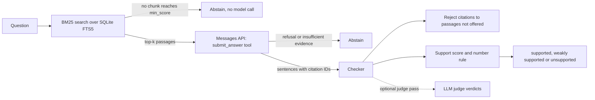

# citecheck

Question answering over your documents where every sentence cites a retrieved passage, and a
checker flags the claims the sources do not support.

[](https://github.com/ult666666/citecheck/actions/workflows/ci.yml)
[](LICENSE)
[](pyproject.toml)

> **Status:** version 0.1.0 of a portfolio project. The demo, the tests and the evaluation run
> offline against hand-written synthetic model responses. Live mode calls the Anthropic API with
> your own key; it was not run against the real API while this repository was built (see
> [Limitations](#limitations-and-roadmap)).

## Why

Answers built from retrieved documents look trustworthy because they come with citations, but a
citation only helps if someone checks it. A model can cite a passage that says something
different, cite a passage it was never shown, or add a sentence that no source supports.

citecheck makes that check mechanical. The model must answer through a JSON schema in which
every sentence carries the IDs of the passages it relies on. A deterministic checker then tests
each sentence against exactly those passages and says, with reasons, which claims the sources do
not back up. When retrieval finds nothing relevant enough, citecheck abstains without calling a
model at all.

The checker is deliberately simple (word overlap plus an exact-number rule) so that every
verdict can be verified by hand, and its blind spots are measured rather than hidden.

## Features

- **Ingestion:** Markdown and text files are split at headings and paragraphs into chunks with
  stable, readable IDs (`people/time-off.md#carryover`) and 1-based source line spans. YAML front
  matter is skipped.
- **Retrieval:** SQLite FTS5 from Python's standard library, Porter stemming and BM25 ranking
  (heading matches count double). Questions are reduced to quoted literal terms, so FTS5 syntax
  in user input is harmless. Chunks below a score threshold are never shown to the model.
- **Answering:** one Messages API call with a strict `submit_answer` tool: sentences, citation
  IDs and an explicit `insufficient_evidence` flag. Only retrieved passages are offered, passage
  text is escaped so a document cannot forge prompt structure, the constant system prompt is
  marked for prompt caching, and server-side refusal fallback is requested.
- **Verification:** citations to passages that were not retrieved are rejected. Each sentence
  gets a support score (the share of its content words found in its cited passages, after a
  documented "stemming-lite" normalization) and a label: supported, weakly supported or
  unsupported. A number that appears in none of the cited passages makes a sentence unsupported.
  An optional LLM-judge pass (`--judge`) is reported next to the lexical label.
- **Interfaces:** a CLI (`index`, `search`, `ask`, `eval`, `serve`), a FastAPI JSON endpoint and a
  small accessible HTML page.
- **Evaluation:** an original, fictional 25-document handbook, 36 labeled questions (8 of them
  unanswerable) and `citecheck eval`, which reports recall@k, citation precision and recall, the
  unsupported-sentence rate, abstention accuracy and how often the checker agrees with human
  labels.
- **Cost and latency:** token counts from the API's `usage` fields (every attempt, priced by the
  model that ran it), cost from a price table you supply (no prices are built in) and
  per-stage timings.
- **Offline by default:** a fixture client replays hand-written synthetic responses, so the
  tests, CI and this README need no API key.

## Quick start

Requires Python 3.12 or newer and [uv](https://docs.astral.sh/uv/). Run the commands from the
repository root.

```bash
git clone https://github.com/ult666666/citecheck.git
cd citecheck
uv sync
uv run citecheck index examples/handbook
```

```text
Indexed 25 documents as 103 chunks into .citecheck/index.sqlite
```

Now ask one of the prepared demo questions. Without `--live` the "model" is a fixture: a
hand-written synthetic response, not a real model's output. This one was written with a
deliberate hallucination in its second sentence.

```bash
uv run citecheck ask "What is the deadline for submitting an expense?"
```

```text
Question: What is the deadline for submitting an expense?
Mode: fixture replay: a hand-written synthetic response, not a real model output

Passages offered to the model (5 of 5 retrieved, k=5, min score 3):
  workplace/expenses.md#submitting-expenses                score  10.82  lines 7-9
  people/learning-budget.md#paying-and-getting-reimbursed  score   5.62  lines 19-21
  workplace/expenses.md#approval-and-payment               score   4.77  lines 15-17
  workplace/expenses.md#receipts                           score   4.74  lines 11-13
  workplace/expenses.md#what-is-not-reimbursed             score   3.63  lines 23-25

Answer:
  1. Submit business expenses in the expense tool within 30 days of the purchase date.
     cites: workplace/expenses.md#submitting-expenses
     -> supported: 9 of 9 content words found in the cited passages
  2. Expenses submitted after 60 days are rejected automatically.
     cites: workplace/expenses.md#submitting-expenses
     -> unsupported: numbers not in the cited passages: 60
        not found in cited passages: 60, after, automatically, reject
Summary: 1 supported, 0 weakly supported, 1 unsupported; 0 rejected citations
Model calls: 1 replayed from fixtures (no API call was made)
Tokens: 1,076 input, 84 output, 0 cache-read, 0 cache-write (estimated at ~4 characters per token, not measured)
Cost: not computed (pass --prices FILE)
Time: retrieval 0.3 ms, model 0.1 ms, verification 0.1 ms, total 0.4 ms
```

The first sentence stays close to its source and passes. The second invents a 60-day rule: "60"
appears in no cited passage, so the sentence is flagged however many other words match.

More to try:

```bash
uv run citecheck search "Who founded Larkmoor Analytics?"            # retrieval only: scores, threshold
uv run citecheck ask "What is Larkmoor's stock ticker symbol?"       # abstains without a model call
uv run citecheck ask --judge "Do I need a doctor's note when I take a sick day?"
uv run citecheck ask --json "How many unused PTO days carry over into the next year?"
uv run citecheck ask --dry-run "How many unused PTO days carry over into the next year?"
uv run citecheck serve                                               # http://127.0.0.1:8000
```

`--dry-run` prints the exact Messages API request without calling anything, and `serve` starts
the JSON API (`POST /api/ask`, `POST /api/search`, `GET /healthz`) with an HTML page at `/`.
The prepared questions are listed in [`eval/questions.json`](eval/questions.json). In fixture
mode, a question that gets past retrieval but has no prepared response is refused with an
error, never answered with an invented one.

## Live mode with your own key

Live mode sends requests to the Anthropic Messages API through the official `anthropic` SDK.
citecheck never reads, stores or prints the key; the SDK finds credentials in
`ANTHROPIC_API_KEY`, `ANTHROPIC_AUTH_TOKEN` or a profile saved by `ant auth login`.

```bash
export ANTHROPIC_API_KEY="your-key"     # or: ant auth login
uv run citecheck index path/to/your/docs
uv run citecheck ask --live "Your question?"
uv run citecheck ask --live --model claude-sonnet-5-5 --effort low "Your question?"
uv run citecheck ask --live --prices my-prices.toml "Your question?"
uv run citecheck serve --live
uv run citecheck eval --live              # real API calls: one per question that clears retrieval
```

What a live request contains, and why:

- **Model:** `claude-opus-5-5` unless `--model` names another.
- **Tool use:** a `submit_answer` tool with `strict: true` and `tool_choice: auto`. Claude Opus 5.5
  and Claude Sonnet 5.5 reject forced tool choice with HTTP 400, so the system prompt asks for the
  tool, the API validates its arguments against the schema, citecheck validates them again, and
  a reply without the tool call is retried once.
- **Effort:** `output_config.effort` is sent explicitly (`medium` by default; `--effort none`
  omits it for models that do not support it). No `temperature` or `thinking` parameter is sent.
- **Refusal fallback:** `fallbacks: "default"` with the `server-side-fallback-2026-07-01` beta
  header, so a policy refusal can be served by another model. citecheck reports when that
  happens and prices each attempt by the model that ran it. `--no-fallback` turns it off.
- **Prompt caching:** a cache breakpoint after the constant system prompt covers the tool
  definition and system prompt (2,785 characters together). Whether that reaches your model's
  minimum cacheable length was not measured, because no live calls were made; if it does, the
  `Tokens` line shows `cache-read` tokens from the second question on. `--no-cache` turns it off.
- **Cost:** pass `--prices FILE`. Start from
  [`examples/prices.example.toml`](examples/prices.example.toml), whose numbers are placeholders,
  not Anthropic's prices, and fill in what you actually pay.

The default score threshold (3.0) was tuned on the demo corpus, and BM25 scores depend on the
corpus, so run `citecheck search` on a few of your own questions and set `--min-score` to match.
In live mode the evaluation cannot report checker-vs-human agreement, because the human labels
belong to the fixture sentences.

## How it works



1. **Index.** Each file is split at headings, and each section into paragraphs packed into chunks
   of at most 1,200 characters. A chunk keeps its heading path ("Expense Reimbursement >
   Submitting expenses"), its line span and an ID built from its path and heading slug.
2. **Retrieve.** The question becomes `"term" OR "term" ...` (stopwords dropped, every term
   quoted). FTS5 ranks chunks with BM25; citecheck keeps the top k (default 5) and offers the
   model only those scoring at least `min_score` (default 3.0). If none qualify, it abstains.
3. **Answer.** The model sees the passages, each wrapped as
   `<passage id="workplace/expenses.md#submitting-expenses" title="...">`, then the question, and
   must call `submit_answer` with sentences, citations and `insufficient_evidence`.
4. **Check.** For each sentence: drop citations to IDs that were not offered; compare the
   sentence's content words with those of its cited passages; reject any number the passages do
   not contain; label by threshold (supported at 0.80 or more, weakly supported at 0.50 or more).

The checker is worth seeing on a known failure. In this fixture the first sentence flips the
policy's meaning but reuses its words, so word overlap rates it supported. The judge pass (here
also a hand-written synthetic response) is what catches it:

```text
  1. A doctor's note is not required for absences of more than 3 consecutive sick days.
     cites: people/time-off.md#sick-leave
     -> supported: 10 of 10 content words found in the cited passages
     judge: not_supported (The passage says a doctor's note is required for absences of more than 3 consecutive sick days; the sentence says the opposite.)
```

[`docs/DESIGN.md`](docs/DESIGN.md) explains every design decision, the verification method and
its limits, the evaluation methodology and the trade-offs.

## Evaluation

```bash
uv run citecheck eval
```

```text
citecheck eval: 36 questions (28 answerable, 8 unanswerable) from questions.json
settings: k=5, min_score=3, supported>=0.80, weak>=0.50
responses: fixture replay: a hand-written synthetic response, not a real model output.
These numbers exercise the harness and the checker; they do not measure any model.

Retrieval (28 answerable questions)
  recall@5                      1.000    share of gold chunks offered, per question
  hit@5                         1.000    questions with at least one gold chunk offered
Citations
  precision                     0.879    29 of 33 cited chunk IDs are gold
  recall                        0.935    29 of 31 gold chunk IDs were cited
  rejected citations            2        cited chunks that were not offered
Verification (49 answer sentences)
  supported                     42
  weakly supported              1
  unsupported                   6
  unsupported-sentence rate     0.122
Abstention
  accuracy                      0.944    34 of 36 questions
  unanswerable, abstained       7 of 8   2 without a model call
  unanswerable, answered        1        answers that should not exist
  answerable, abstained         1 of 28
Checker vs. human labels in the fixtures
  flagged 5 of 7 sentences labelled unsupported (missed 2)
  flagged 2 of 42 sentences labelled supported (false flags)
Tokens (estimated at ~4 characters per token, not measured): 34 model calls, 34,802 input, 2,133 output, 0 cache-read, 0 cache-write
```

**Read this as a test of the harness, not of a model.** The responses are hand-written synthetic
fixtures, and several are wrong on purpose; [`eval/README.md`](eval/README.md) lists each
deliberate error. The questions, gold labels, fixtures, human labels and the 3.0 score
threshold were all written or chosen by the same author, the threshold was picked by looking at
this same question set, and 36 questions are far too few for statistical claims. A test
(`tests/test_readme.py`) fails if the block above drifts from what `citecheck eval` prints.

What the numbers do show:

- **Retrieval** offers every gold chunk (recall@5 = 1.000), on a 103-chunk corpus whose
  questions use the documents' own vocabulary: an easy setting for BM25.
- **Citations:** the 4 non-gold citations are the deliberate errors (an over-cited passage, a
  typo'd chunk ID, a chunk ID that does not exist) plus the citation in the one answer to an
  unanswerable question. The 2 rejected citations are the typo and the nonexistent ID.
- **The checker** flags 5 of the 7 sentences a human labeled unsupported: the invented 60-day
  rule, a wrong $25 fee, an uncited opinion, a sentence whose only citation is mistyped, and
  an added "notify your manager". It misses the negation flip shown above and an answer that
  gives the domestic per diem for international trips (5 of 6 words match), and it falsely flags
  2 correct sentences: a paraphrase in different words and a sentence that repeats the
  question's "$5,000". Those four errors are the method's documented blind spots.

## Development

```bash
uv sync                                   # installs the dev tools as well
uv run ruff check .
uv run ruff format --check .
uv run mypy                               # strict mode, src and tests
uv run pytest --cov=citecheck --cov-report=term-missing --cov-fail-under=90
```

```text
src/citecheck/
  chunking.py    files -> chunks with stable IDs and line spans
  index.py       SQLite FTS5 index (build, search with bm25())
  retrieval.py   safe FTS5 queries and the abstention threshold
  prompts.py     system prompts, tool schemas, passage rendering
  llm.py         ModelClient protocol, Anthropic SDK adapter, tool-call retry
  fixtures.py    replay of hand-written synthetic responses
  answer.py      asks for and validates the cited answer
  verify.py      citation and lexical-support checks
  judge.py       optional LLM judge
  costs.py       usage totals and Decimal cost from a price table
  pipeline.py    retrieve -> answer -> verify -> judge -> account
  evaluation.py  metrics over a labeled question set
  cli.py, api.py, static/index.html
```

The tests never touch the network: an autouse fixture replaces `anthropic.Anthropic` with a
constructor that fails the test, and the live adapter is tested with real SDK response types and
a stand-in client. Hypothesis property tests check, among other things, that any user string
becomes a query SQLite accepts. CI runs the same checks on Python 3.12 and 3.13, with no API key.

## Limitations and roadmap

**Limitations**

- **Lexical support is not entailment.** Word overlap cannot see negation scope, word order or
  meaning: a sentence that reverses its source with the same words passes, and a faithful
  paraphrase in different words is flagged. Modal verbs are ignored, so "must" and "may" look
  the same.
- **The number rule is blunt.** It catches invented figures, but it also flags a correct
  sentence that repeats a number from the question.
- **More citations make passing easier.** Support is measured against the union of the cited
  passages, so over-citing raises a sentence's score; citation precision in the evaluation is
  the counterweight.
- **Retrieval is lexical.** BM25 misses synonyms ("staff" vs "employees"), and the Porter
  stemmer conflates some unrelated words ("international" matches "internal" in this corpus).
- **The evaluation is tiny and self-made.** One author wrote the corpus, questions, gold labels,
  fixtures and human labels, and calibrated the threshold on the same questions.
- **Unverified here:** live API calls (never made while building this) and the hosted CI run
  (the workflow is included but has not run on GitHub yet). Token counts in fixture mode are
  estimates.
- **Ingestion is basic:** Markdown ATX headings and plain text only (no PDF, HTML or setext
  headings), a paragraph is never split, the index is rebuilt from scratch, and the text
  normalization is English-only.

**Roadmap**

- Run the evaluation against live models, with the judge as a second annotator and labels from
  people other than the author.
- Offer an entailment (NLI) model as an alternative checker and compare it with the lexical one.
- Hybrid retrieval (BM25 plus embeddings) with reranking; PDF and HTML ingestion; incremental
  indexing.
- A cost preview before live calls using the token-counting endpoint.

## License

[MIT](LICENSE), copyright (c) 2026 Charles Dai. The handbook in `examples/handbook` is fictional
and was written for this project.
