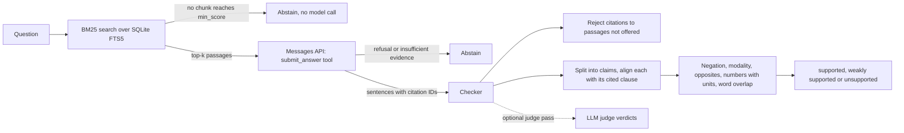

# citecheck

citecheck answers questions about a folder of Markdown or text files. Each sentence of an answer
must cite the passages it relies on, and a rule-based checker flags the sentences that those
passages do not support.

[](https://github.com/ult666666/citecheck/actions/workflows/ci.yml)
[](LICENSE)
[](pyproject.toml)

A citation only helps if someone checks it. A model can cite a passage that says something
else, or add a sentence that no source supports. citecheck does that check without a model, with
rules simple enough to recompute by hand.

## Try it

The demo runs offline on a bundled handbook for a fictional company. It needs Python 3.12 or
newer and [uv](https://docs.astral.sh/uv/).

```bash
git clone https://github.com/ult666666/citecheck.git && cd citecheck
uv sync
uv run citecheck index examples/handbook
uv run citecheck ask "What is the deadline for submitting an expense?"
```

```text
Indexed 25 documents as 103 chunks into .citecheck/index.sqlite
```

Without `--live`, the answer is a fixture: a hand-written response replayed in place of a model
call. This one has a mistake planted in its second sentence.

```text
Question: What is the deadline for submitting an expense?
Mode: fixture replay: a hand-written synthetic response, not a real model output

Passages offered to the model (5 of 5 retrieved, k=5, min score 3):
  workplace/expenses.md#submitting-expenses                score  10.82  lines 7-9
  people/learning-budget.md#paying-and-getting-reimbursed  score   5.62  lines 19-21
  workplace/expenses.md#approval-and-payment               score   4.77  lines 15-17
  workplace/expenses.md#receipts                           score   4.74  lines 11-13
  workplace/expenses.md#what-is-not-reimbursed             score   3.63  lines 23-25

Answer:
  1. Submit business expenses in the expense tool within 30 days of the purchase date.
     cites: workplace/expenses.md#submitting-expenses
     -> supported: 9 of 9 content words found in the cited passages
  2. Expenses submitted after 60 days are rejected automatically.
     cites: workplace/expenses.md#submitting-expenses
     -> unsupported: the claim says 60 days where the cited text says 30 days
        not found in cited passages: 60, after, automatically, reject
Summary: 1 supported, 0 weakly supported, 1 unsupported; 0 rejected citations
Model calls: 1 replayed from fixtures (no API call was made)
Tokens: 1,076 input, 84 output, 0 cache-read, 0 cache-write (estimated at ~4 characters per token, not measured)
Cost: not computed (pass --prices FILE)
Time: retrieval 0.3 ms, model 0.1 ms, verification 0.1 ms, total 0.4 ms
```

The first sentence restates its source and passes. The second invents a 60-day rule. The cited
sentence gives the deadline as 30 days, so the claim is flagged however many other words match.

`uv run citecheck serve` shows the same check as a web page at http://127.0.0.1:8000.
[docs/USAGE.md](docs/USAGE.md) covers the other commands, installing the CLI for your own files,
and live mode with your own Anthropic API key.

## What the checker catches

The checker splits each sentence into claims and lines up each claim with the cited clause it
restates. It flags a claim when that clause disagrees with it on negation, on "must" against
"may", on a word swapped for its opposite (from a list of 37 pairs), or on a number or its unit
("72 days" against "72 hours"). Claims that pass those checks are labelled by how many of their
content words appear in the cited passages. A citation to a passage that was never retrieved is
rejected.

The rules catch what word overlap misses. In this fixture the first sentence reverses the policy
but reuses all of its words, so the original word-overlap checker (`--checker lexical`) rates it
supported. The default checker compares it with the cited sentence, "A doctor's note is required
only for absences of more than 3 consecutive sick days.", and flags it:

```text
  1. A doctor's note is not required for absences of more than 3 consecutive sick days.
     cites: people/time-off.md#sick-leave
     -> unsupported: only the claim is negated: 'A doctor's note is required only for absences of more than 3 consecutive sick days.'
```

## How well it works

The two checkers were scored on 77 held-out sentences, each labelled supported or unsupported by
hand. The claim rules were tuned on a separate dev split.

| On 77 held-out sentences | Word overlap (`--checker lexical`) | Claim-level (default) |
| --- | ---: | ---: |
| Unsupported sentences caught | 20 of 48 | 44 of 48 |
| Supported sentences wrongly flagged | 1 of 29 | 2 of 29 |
| Accuracy | 0.623 | 0.922 |

Paired on the same cases, the claim-level checker is right where the lexical one is wrong 24
times, and the reverse happens once. An exact McNemar test gives p = 1.5e-06. The same person
wrote the cases and the rules, so treat these figures as optimistic.
[docs/EVALUATION.md](docs/EVALUATION.md) has the full reports, the dev split and an end-to-end
evaluation of retrieval, citations and abstention.

## How it works



1. `index` splits each file at headings, and each section into paragraphs packed into chunks of
   at most 1,200 characters. A chunk keeps its heading path, its line span and a readable ID such
   as `people/time-off.md#carryover`.
2. Retrieval turns the question into a query of quoted terms, so user input cannot inject FTS5
   syntax. SQLite FTS5 ranks chunks with BM25, and only chunks that reach the score threshold are
   offered to the model. If none do, citecheck abstains without calling a model.
3. The model sees the passages, then the question, and must call a strict `submit_answer` tool
   with sentences, citation IDs and an `insufficient_evidence` flag.
4. The checker gives each sentence the label of its worst claim: supported when at least 80% of
   its content words appear in the cited passages, weakly supported from 50%, and otherwise
   unsupported. An optional LLM judge (`--judge`) reports its verdict next to the label.

[docs/DESIGN.md](docs/DESIGN.md) explains each decision: chunking, retrieval, the prompt and
schema, the checker, the evaluation method, cost accounting and the trade-offs.

## Development

```bash
uv sync                                   # installs the dev tools as well
uv run ruff check .
uv run ruff format --check .
uv run mypy                               # strict mode, src and tests
uv run pytest --cov=citecheck --cov-report=term-missing --cov-fail-under=90
```

```text
src/citecheck/
  chunking.py    files -> chunks with stable IDs and line spans
  index.py       SQLite FTS5 index (build, search with bm25())
  retrieval.py   safe FTS5 queries and the abstention threshold
  prompts.py     system prompts, tool schemas, passage rendering
  llm.py         ModelClient protocol, Anthropic SDK adapter, tool-call retry
  fixtures.py    replay of hand-written synthetic responses
  answer.py      asks for and validates the cited answer
  verify.py      citation checks, word overlap and labels
  claims.py      claim splitting, clause alignment, negation, modality, opposites, quantities
  judge.py       optional LLM judge
  costs.py       usage totals and Decimal cost from a price table
  pipeline.py    retrieve -> answer -> verify -> judge -> account
  evaluation.py  metrics over a labeled question set
  cli.py, api.py, static/index.html
```

The tests never touch the network: a fixture replaces `anthropic.Anthropic` with a constructor
that fails the test, and the live adapter is tested with real SDK response types and a stand-in
client. Hypothesis property tests check, among other things, that any user string becomes a
query SQLite accepts. CI runs these checks on Python 3.12 and 3.13, then runs the CLI offline,
with no API key.

## Limits

- The claim checks are rules, not entailment: they miss swapped names, values swapped within one
  sentence, dropped restrictions and contradictions outside the list of opposites, and they can
  flag a faithful paraphrase.
- Support is measured against the union of the cited passages, so citing extra passages makes
  passing easier.
- Retrieval is lexical, so BM25 misses synonyms, and the Porter stemmer conflates some unrelated
  words.
- One author wrote the corpus, questions, labels, fixtures, claim cases and rules, so the
  evaluation is small and its figures are optimistic.
- Live mode is not exercised in CI and was not run against the real API while this was built.

[docs/DESIGN.md](docs/DESIGN.md#13-limitations-and-roadmap) lists every limit in detail, with the
roadmap.

## License

[MIT](LICENSE), copyright (c) 2026 Charles Dai. The handbook in `examples/handbook` is fictional
and was written for this project. Built with AI coding assistants.
